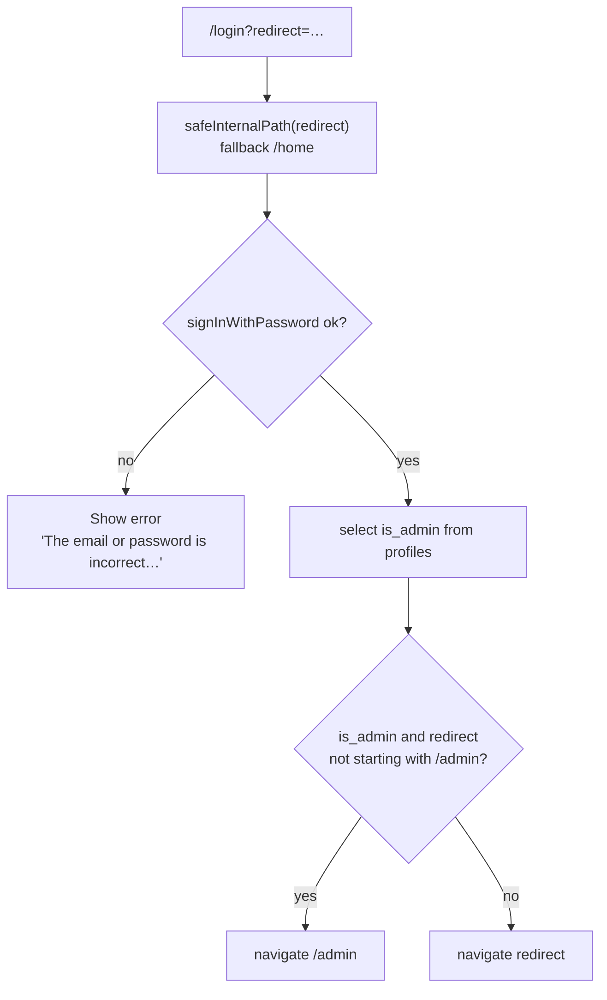
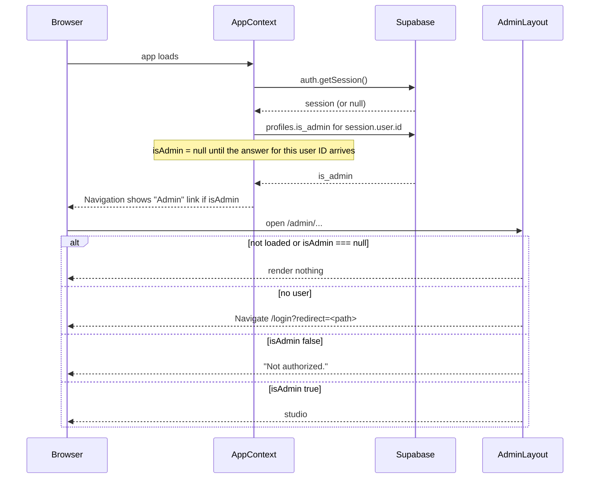

# Authentication and admin routing

Covers FR-013, FR-016 and FR-021. Source: `src/pages/Login.jsx`, `src/context/AppContext.jsx`, `src/pages/admin/AdminLayout.jsx`.

## Sign-in redirect

## Admin guard and entry points

The UI guard is display-only. Data protection depends on RLS (R-02).
