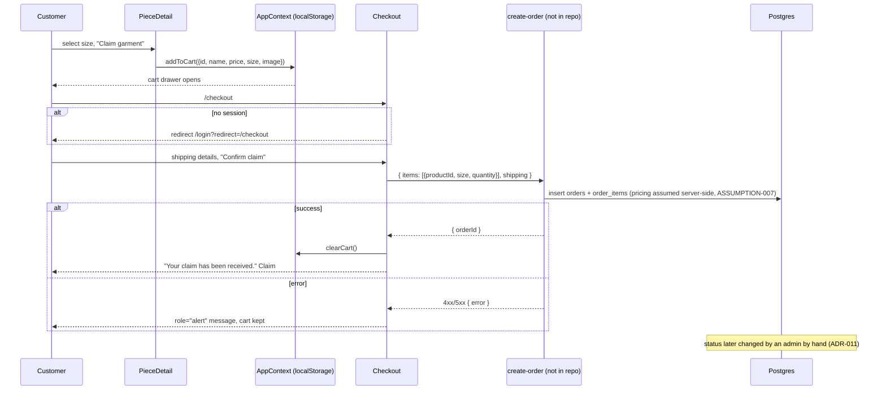
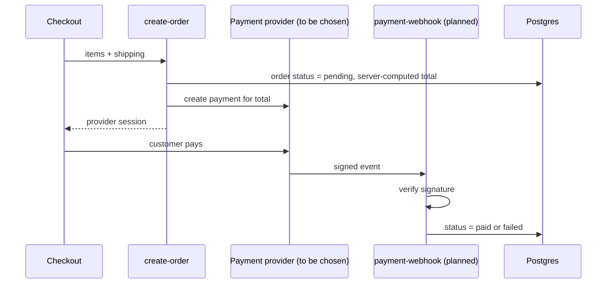

# Checkout

Covers FR-009, FR-010 and FR-011. Source: `src/pages/PieceDetail.jsx`, `src/components/CartDrawer.jsx`, `src/pages/Checkout.jsx`.

## As built

## Planned payment step (FR-011, PH-4, not built)

