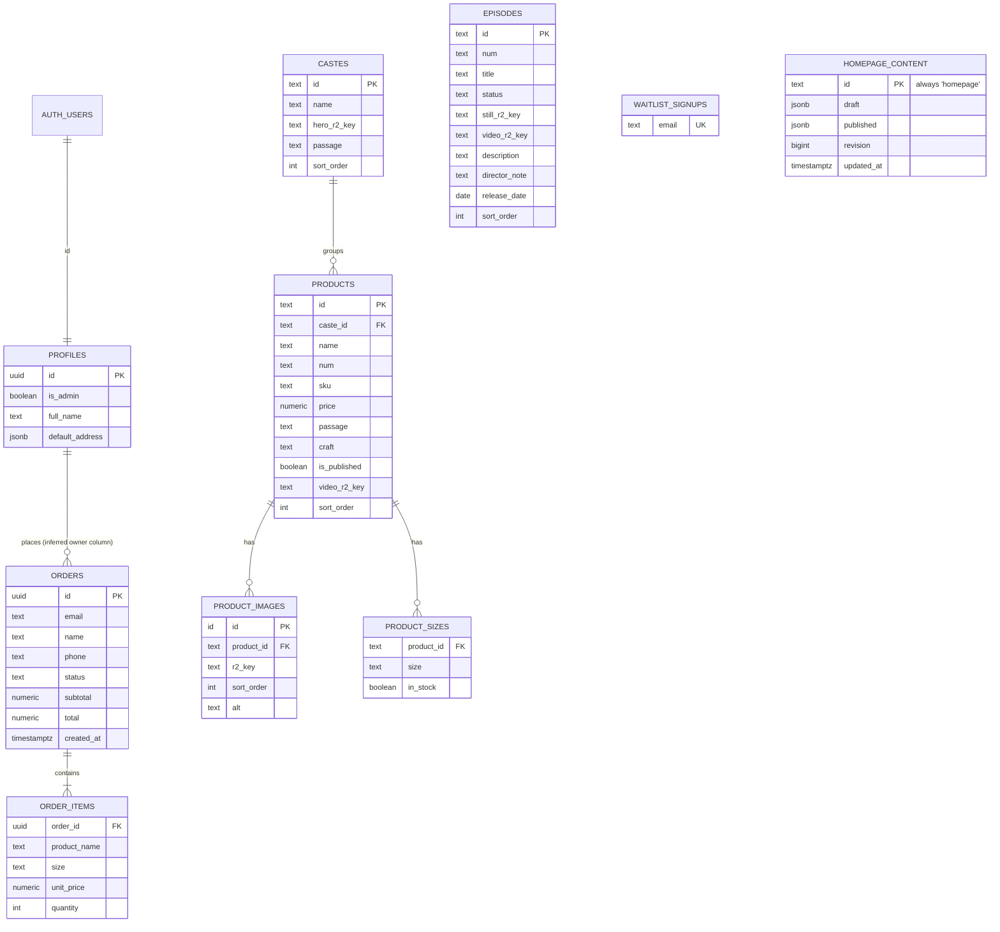

# Data model

Explained in [architecture/data-model.md](../architecture/data-model.md). Only `HOMEPAGE_CONTENT` is defined in the repository. Every other entity and relationship is inferred from frontend queries.

`TOP_PRODUCTS` (ASSUMPTION-009) is a read-only view over `ORDER_ITEMS` and `ORDERS`, so it is not drawn as an entity.
