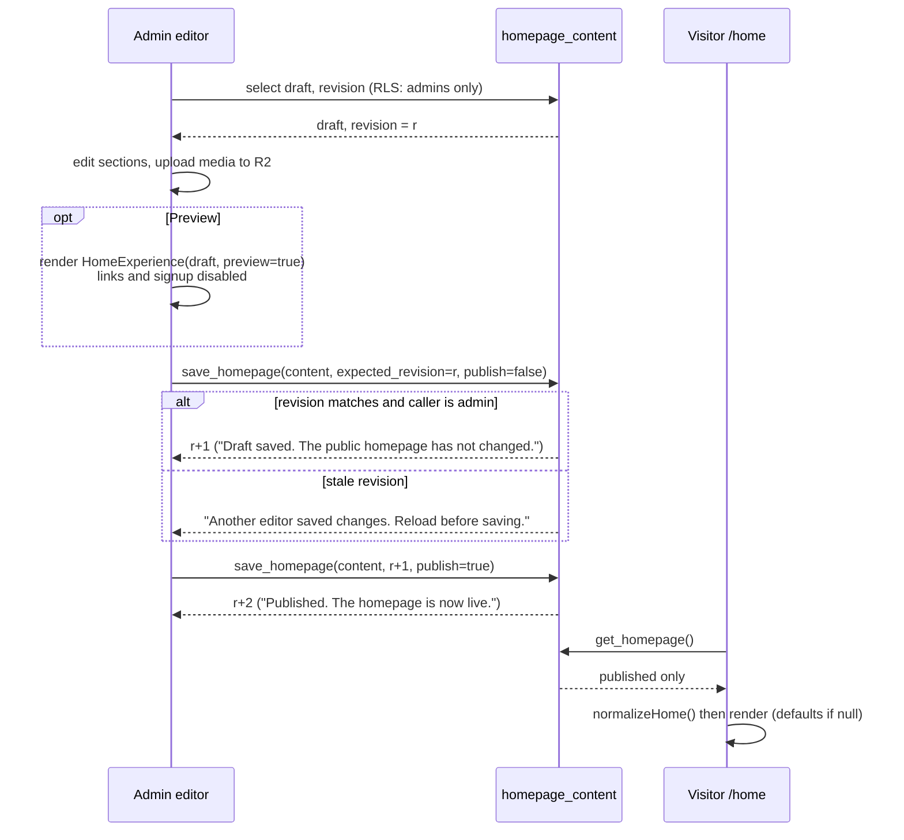

# Homepage draft, preview and publish

Covers FR-003 and FR-027. Source: `src/pages/admin/AdminHomepage.jsx`, `supabase/migrations/202610150001_homepage.sql`. Guide: [docs/homepage.md](../docs/homepage.md).

